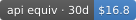
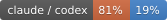

# token-history

**A day-by-day record of my AI-assisted development — snapshotted to git and rendered as self-updating charts.**

  

  

---

This is my personal token-usage ledger. Every day, a scheduled job reads the local
usage logs of the AI coding tools I actually use, writes the numbers into this
repo as plain JSON, and GitHub Actions re-renders the charts below. It's a
persistent, owned history of how much I build with AI — a kind of contribution
graph for AI-assisted work, and proof of steady activity over the months.

## What I track

I don't use Claude Code or Codex. My day-to-day work runs through:

| Tool | What it is |
|---|---|
| **Hermes** | my primary agent runtime |
| **Kilo Code** | VS Code coding agent (where most of the early months happened) |
| **Kimi** | occasional Kimi CLI usage |

The models doing the heavy lifting have shifted over time — `mimo-v2.5-pro` carried
the first couple of months, later giving way to `deepseek-v4.1-flash`,
`kimi-k3-1`, `qwen3.8-flash`, and `glm-5.2-x`. The model charts below make those
eras visible.

## Headline charts

**Daily tokens — the last 30 days, stacked by tool**

**Contribution-style calendar — the whole record at a glance**

**Month by month, stacked by tool**

## By model

Which models actually did the work, and when.

**Every model, ranked by tokens** (colored by the tool that ran it)

**Monthly tokens stacked by model** — the `mimo-v2.5-pro` era is plainly visible

## The rest of the gallery

Every render produces the full set; these are the styles I like.

<b>Stat card, terminal, sketch, ledger, area, pixel, and badges</b>

**30-day stat card**

**The record as a terminal session**

**Hand-drawn (xkcd-style)**

**Weekly ledger, newest week on top**

**Smoothed stacked area**

**8-bit pixel bars**

**Badges** — inline-sized, drop any on a single line

     

## How mine runs

- A Windows Task Scheduler job runs three times a day (00:30 / 12:00 / 21:00) and
  snapshots local usage via [`ccusage`](https://github.com/ccusage/ccusage) into
  `data/<host>/<date>.json` — one file per day, plain JSON.
- The job commits and pushes; a GitHub Actions workflow re-renders every chart on
  each data push, so the SVGs above are always current.
- The collector is idempotent and self-healing: re-running a day is safe, and a
  missed run backfills itself. Old days may only grow, so a cleaned-up local log
  can never shrink a number already on record.
- Nothing identifying is stored — no project names, paths, or prompts; only
  per-day token counts and model names, under a neutral host alias.

The numbers are API-equivalent value at published rates — what the usage *would*
cost, not what I paid on a subscription.

## Credits & license

This is a **fork of [keli-wen/token-history](https://github.com/keli-wen/token-history)**
by [@keli-wen](https://github.com/keli-wen). All of the chart-rendering engine and
visual design are theirs; this repo is my personal deployment of it. If you want
the original project, its setup guide, or the full design rationale, go to the
upstream repo — that's the source of truth.

- Usage parsing is entirely by [**ccusage**](https://github.com/ccusage/ccusage),
  the de-facto standard for reading local AI-CLI usage logs.
- Changes in this fork: the collector and renderer were generalized from the
  original two sources to an arbitrary, config-driven set, and model-level
  breakdown charts (`charts/model/*`) were added.
- Licensed under **MIT** — see [LICENSE](./LICENSE), which retains the original
  copyright notice.
